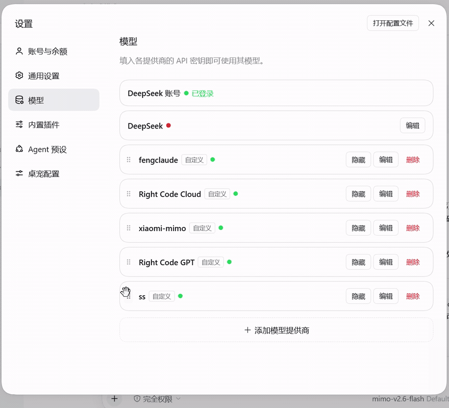

# dsh-models-sort

给 DeepSeek Harness（DSH）设置页的**模型供应商列表**加上 **CC Switch 式拖拽排序**与**隐藏**能力。

按住卡片左侧的 `⠿` 手柄上下拖动，周围的卡片会边压边让开，松手顺序立即生效，同时写回配置永久保存。每张卡片还有一个「隐藏」按钮，隐藏的供应商集中到列表底部的「已隐藏」分组，并从聊天框的模型选择器里移除。



---

## 安装（一行）

```
dsh plugin add github:Faust-zyb/dsh-models-sort
```

桌面版也可以走 **设置 → 插件 → 从来源安装**，或直接对 DSH 说「帮我装 github:Faust-zyb/dsh-models-sort」。安装后重启一次 DSH。npm 与手动方式见下文。

---

## 功能

**拖拽排序**
- 卡片贴着指针 1:1 跟随，不跳格、不掉手；
- 连续让位：拖动卡片的边一压到别的卡片，那张卡片立刻顺方向滑开，压多深让多少，最多让一格，全程无跳变；
- 上下左右方向都能拖，落点按位移四舍五入到最近槽位；
- 顺序**立即生效**（运行时重排，无需重启），并写回 `cordis.patch.yml` 永久保存；
- 聊天框模型选择器的分组顺序跟着一起变；
- 单纯点击手柄不会改变卡片尺寸或触发动画；
- 尊重系统「减少动态效果」设置。

**隐藏供应商**
- 每张卡片的操作区多一个「隐藏」按钮（外观与「编辑」按钮完全一致）；
- 隐藏后卡片变淡、按钮变「显示」，自动移到列表底部的「已隐藏」分组；
- **聊天框模型选择器里这家的所有模型不再显示**，设置页保留该行，随时点「显示」恢复；
- 只影响选择器，不影响已配置的密钥和路由。

---

## 安装

三种方式任选其一。安装后**重启一次 DSH** 生效。

### 方式 A：DSH 插件管理页（推荐）

1. 打开 DSH 设置 → 插件（模型之外的插件管理页）；
2. 选择「从 npm 安装」或「从本地安装」，填入包名 `dsh-models-sort`（或本地目录 / 压缩包路径）；
3. 安装完成后重启 DSH。

### 方式 B：让 DSH 帮你装

DSH 内置了插件管理工具，直接对 DSH 说：

> 帮我安装插件 dsh-models-sort

或指定来源：

> 帮我安装插件，路径是 `C:\Downloads\dsh-models-sort`

DSH 会调用 `install_bundle`（底层是 `pnpm add`），支持 npm 包名、本地目录、`.tgz` 压缩包、GitHub 仓库，并自动写入 `dsh.profile.bundles` 启用。

### 方式 C：手动安装

1. 把本目录整个复制到 DSH 配置目录的 `node_modules` 下：

   ```
   %USERPROFILE%\.dsh\profiles\desktop\node_modules\dsh-models-sort\
   ```

2. 编辑同目录下的 `package.json`，把 `dsh-models-sort` 加进 `dsh.profile.bundles`：

   ```json
   "dsh": {
     "profile": {
       "bundles": ["dsh-pet", "dsh-models-sort"]
     }
   }
   ```

3. 重启 DSH。

---

## 卸载

- 插件管理页点「卸载」，或对 DSH 说「帮我卸载插件 dsh-models-sort」（`remove_bundle`）；
- 手动安装的，删掉 `node_modules/dsh-models-sort` 并从 `dsh.profile.bundles` 移除即可。

卸载后拖拽手柄与隐藏按钮消失，供应商顺序保持卸载前的最后一次保存值（顺序本来就写在 `cordis.patch.yml` 里，不受卸载影响）。

---

## 数据与文件

| 文件 | 说明 |
| --- | --- |
| `%USERPROFILE%\.dsh\profiles\desktop\cordis.patch.yml` | 供应商顺序的持久化位置（插件直接改写 `providers:` 段的顺序） |
| `cordis.patch.yml.bak-<时间戳>` | 每次改写前的自动备份，可手动回滚 |
| `%USERPROFILE%\.dsh\profiles\desktop\dsh-models-sort.hidden.json` | 隐藏的供应商键列表 |
| `%TEMP%\dsh-models-sort.log` | 运行日志，排查问题用 |

> 安全性：改写 `cordis.patch.yml` 时会先备份，只调整 `providers:` 下各块的**顺序**，不改动任何字段内容。

---

## 与同类插件的区别

生态里已经有两个做"模型顺序"的插件，先说清楚差异，免得你装重了：

| | 本插件 | dsh-llm-providers-ui | dsh-model-priority |
| --- | --- | --- | --- |
| 做法 | 增强现有设置页（DOM 层） | **接管**整个 LLM 供应商设置页 | 增强 + 改写宿主返回顺序 |
| 拖拽排序 | ✅ | ✅ | ✅ |
| **隐藏整行供应商** | ✅ | ❌ | ❌ |
| 顺序写回 | `cordis.patch.yml`（带备份） | 自己的 settings 命名空间 | `settings.yaml`（带备份） |
| 依赖 | 仅 DOM，装上即用 | 需要各供应商插件配合注册卡片 | 需要装它自己的宿主侧 |

**结论**：如果你只是想要"能拖动排序"，三个都能用；本插件独有的部分是**隐藏**——把某家供应商从聊天模型选择器里摘掉、但设置页保留随时恢复。

> ⚠️ 与本插件**不兼容**：`dsh-llm-providers-ui` 会接管并重绘整个设置页，本插件靠识别「编辑/删除」按钮来找卡片，页面被接管后会失效（不会报错，只是不生效）。两者请二选一。

---

## 兼容性

| DSH 版本 | 状态 |
| --- | --- |
| 0.2.1-rc.2 | 兼容（实测） |
| 0.2.0-rc.x / 0.1.7-rc.2 | 未测试 |

本插件用到了 DSH 的内部接口（`llm.adapters` / `llm.listProviders` / `llm.listConfigurableProviders`），并以 DOM 方式增强设置页。**DSH 大版本更新后可能失效**，届时请等插件更新或提 Issue。

---

## 已知限制

- 只能排序**自定义**供应商；内置的 DeepSeek 账号 / 官方行固定在最前（DSH 自身的排序规则）；
- 隐藏当前正在使用的供应商会让当前模型选择失效，请先换一个模型再隐藏；
- 首次拖拽后如发现顺序未同步到聊天选择器，重启一次 DSH 即可（运行时同步依赖内部接口）。

---

## License

MIT
